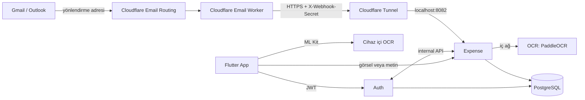

# Fissio

Akıllı fiş işleme ve mikro harcama yönetimi. Fişin fotoğrafını çekin; Fissio metni okuyup mağaza, tarih, toplam ve ürün kalemlerini çıkarır, kategorilere ayırır ve harcamalarınızı raporlar.

## Özellikler

- **Fiş tarama (OCR):** Uygulama içi kamera (hizalama çerçevesi, flaş/fener, dokunarak odak; izin reddinde ayarlara yönlendirme) veya galeriden, uzun fişler için en fazla 6 sayfa. Sunucu OCR (PaddleOCR) ya da cihaz içi OCR (ML Kit). Bir sayfa okunamazsa yalnızca o sayfa yeniden taranabilir.
- **Otomatik ayrıştırma:** Mağaza, tarih, toplam, ürün kalemleri; toplam uyuşmazlığında inceleme uyarısı. Aynı ayrıştırma mantığı sunucuda (Go) ve cihazda (Dart) ortak altın vektörlerle (`testdata/`) sınanır.
- **Otomatik kategorilendirme:** 11 kategorili sözlük + düzeltmelerinizden öğrenen kişisel kurallar.
- **Bütçeler, sabit giderler, ana ekran widget'ı:** Kategori/toplam bütçe uyarıları, sabit ve değişken faturalar (gecikmiş ödeme hatırlatması dahil).
- **Profiller:** Her hesapta birden fazla harcama profili (varsayılan "Kişisel").
- **Çevrimdışı kullanım ve bulut eşitleme:** Bağlantı yokken fişler cihazda kuyruğa alınır, bağlantı gelince eşitlenir. Eşitleme kapalıyken hiçbir veri (okunan metin dahil) sunucuya gitmez.
- **Güvenli hesap:** E-posta doğrulama kodu (OTP), kısa ömürlü erişim + yenilenen oturum belirteci, oturum yönetimi, kod ile şifre sıfırlama, hesap silme.
- **Dijital fiş (PDF / e-posta):** E-fatura PDF'i, `.eml` ve HTML sipariş özeti "Paylaş → Fissio" ile cihazda okunur; ayrıca Gmail/Outlook filtresi ya da "İlet" ile kullanıcıya özel adrese yönlendirilen e-postalar otomatik kaydedilir. Sipariş özeti + sonradan gelen resmi fatura tek fişte birleşir, aynı belge/sipariş ikinci kez eklenmez.
- **Veri taşıma:** JSON yedek ve CSV dışa/içe aktarma.
- **Kişiselleştirme:** Açık/koyu tema, vurgu rengi, fiş detay görünümü.

## Mimari

| Bileşen | Teknoloji | Erişim |
|---|---|---|
| `services/auth` | Go (gin) | geliştirmede `localhost:8081` |
| `services/expense` | Go (gin); `internal/receiptparse` (saf ayrıştırma), `internal/digital` (dijital fiş: HTML/PDF/.eml/UBL-XML), `internal/scan` (OCR istemcisi) | geliştirmede `localhost:8082` |
| `services/ocr` | Python 3.11, FastAPI, PaddleOCR | **yalnızca Docker iç ağı** (`http://ocr:8080`; kimlik doğrulaması yoktur, host'a açılmaz) |
| PostgreSQL | postgres:16 | yalnızca Docker iç ağı; şemalar `auth` ve `expense` |
| `fissio_mobile/` | Flutter | - |



Servisler birbirinin veritabanı şemasına dokunmaz: oturum doğrulama ve hesap silme, ayrı bir iç portta (`INTERNAL_PORT`, host'a yayınlanmaz) `INTERNAL_TOKEN` ile korunan iç API'ler üzerinden yapılır.

## Hızlı başlangıç

### Backend

```bash
cp .env.example .env        # varsayılanlar geliştirme için yeterli
docker compose up --build
```

- Auth: http://localhost:8081/health
- Expense: http://localhost:8082/health
- OCR ve PostgreSQL dışarı açılmaz. Yerel hata ayıklama için `docker-compose.override.yml` ile `ports: ["127.0.0.1:8083:8080"]` eklenebilir.
- Geliştirmede e-posta doğrulama kodu SMTP olmadan (`SMTP_HOST` boş) loga yazılır: `docker compose logs auth | grep DEV-OTP`
- Bu makinede `docker compose build` bazen "bake" hatası verir; çözüm: `docker build -t fissio-auth services/auth` (expense, ocr için aynısı), ardından `docker compose up -d --no-build`.

### Yayın (production)

```bash
# .env: APP_ENV=production, güçlü sırlar, FISSIO_DOMAIN=api.ornek.com (bkz. .env.example "Yayın sertleştirmesi")
docker compose -f docker-compose.yml -f docker-compose.prod.yml up -d --build
```

- **Caddy** otomatik TLS ile tek origin sunar (`/auth/*` → auth, geri kalanı → expense); auth/expense host portları kapanır.
- `APP_ENV=production` iken zayıf/varsayılan sırlarla servisler başlamaz.
- Önerilen: servis başına DB rolleri (`db/10-roles.sh`, mevcut veritabanı için `db/migrate-roles.sql`) ve asimetrik JWT (`docker compose run --rm auth /app genkey`).
- Mobil derleme: `flutter build apk --release --dart-define=API_BASE=https://api.ornek.com` (release derlemeler düz HTTP'ye bağlanamaz). Yayın imzası için `fissio_mobile/android/key.properties.example`.

### E-posta ile otomatik fiş aktarımı (geliştirme: Cloudflare Quick Tunnel)

Mail akışı: Gmail/Outlook → Cloudflare Email Routing (catch-all) → Email Worker → tünel → `POST /webhooks/inbound-email` (expense). Yerel makine internete açık olmadığından geliştirmede Worker, **Quick Tunnel** ile yerel expense servisine ulaşır. Worker kodu ve ayrıntılı teşhis: `docs/cloudflare-email-worker.md`.

1. `.env` içinde `INBOUND_EMAIL_DOMAIN` (örn. `fissio.dev`) ve `INBOUND_WEBHOOK_SECRET` dolu olmalı. Sırrı düz hex üretin (yapıştırırken bozulmaz): `openssl rand -hex 32` ya da PowerShell: `-join ((1..32) | % { '{0:x2}' -f (Get-Random -Maximum 256) })`. Değiştirince expense'i yeniden oluşturun: `docker compose up -d --no-build --force-recreate expense`.
2. Tüneli açın ve penceresini **kapatmayın**: `cloudflared tunnel --url http://localhost:8082`
3. Tünel adresini okuyun (çıktıyı bulamazsanız): `curl http://127.0.0.1:20241/quicktunnel` → `{"hostname":"....trycloudflare.com"}`
4. Cloudflare → Workers & Pages → `fissio-inbound-worker` → Settings → Variables and Secrets:
   - `FISSIO_API_BASE` = `https://<hostname>` (sonda `/` yok)
   - `INBOUND_WEBHOOK_SECRET` = **Secret**, `.env` ile birebir aynı (başta/sonda boşluk yok)
   - isteğe bağlı: `INBOUND_MAX_BYTES`, `REJECT_OVERSIZE`, `DEBUG_AUTH`
   - **Save and deploy**. Worker kodunu "Edit code" ile yeniden deploy ederseniz değişkenlerin silinmediğini kontrol edin.
5. Doğrulama: `curl -s -o /dev/null -w "%{http_code}" -X POST -H "X-Webhook-Secret: x" https://<hostname>/webhooks/inbound-email` → **401** (uç ayakta). Sonra bir sipariş mailini kullanıcının yönlendirme adresine iletin; uygulamada Ayarlar → E-Posta sihirbazı → "Son Aktarılan E-Postalar" listesinde satır çıkar. Veritabanından: `select received_at,status,reason from expense.inbound_history order by id desc limit 5;`

**Sınırlar:** Quick Tunnel adresi geçicidir; tünel kapanır ya da bilgisayar yeniden başlarsa adres değişir ve 4. adımdaki `FISSIO_API_BASE` güncellenmelidir. Bilgisayar kapalıyken gelen mail işlenmez (Worker maili reddetmez, mail kullanıcının kutusunda durur; sonradan Paylaş → Fissio ile eklenebilir). Kalıcı çözüm adlandırılmış tünel + sabit alt alan adı ya da sunucuya taşımadır (bkz. `ROADMAP.md`).

**Sık görülen Worker günlük mesajları**

| Mesaj | Anlam / çözüm |
|---|---|
| `FISSIO_API_BASE / INBOUND_WEBHOOK_SECRET tanımlı değil` | Worker değişkenleri yok ya da silinmiş (deploy sonrası sık olur); Variables sayfasından yeniden girin |
| `webhook sırrı reddedildi (401)` | Worker ve `.env` sırrı farklı; yeni düz hex sır üretip ikisine de girin, expense'i yeniden oluşturun |
| `mail işlenemedi … fetch failed` / 530 / 1033 | Tünel kapalı ya da `FISSIO_API_BASE` eski adres |
| `sunucu boyut sınırı nedeniyle reddetti (413)` | `INBOUND_MAX_BYTES` Worker ve sunucuda eşit değil |

### Mobil

```bash
cd fissio_mobile
flutter pub get
flutter run
```

Android emülatöründe backend adresi `http://10.0.2.2:8081` (auth) / `:8082` (expense), diğer platformlarda `localhost`; gerçek cihazda `--dart-define=API_HOST=192.168.x.x`. Düz HTTP yalnızca debug/profile derlemelerinde açıktır.

## Mobil kullanım

- **Yeni fiş (+):** Doğrudan tarama sayfasını açar. Fişi taramak istemezseniz tarama ekranındaki **Manuel** anahtarıyla formu elle doldurabilirsiniz.
- **Fiş okuma ayarları** (Ayarlar > Tercihler > Fiş okuma):
  - Mod: **Otomatik** (bağlantı varken sunucu, yoksa cihaz), **Sunucu** veya **Cihaz içi** OCR. Eşitleme kapalıyken fotoğraf her zaman cihazda kalır; eşitleme açık ve çevrimiçiyken cihazda okunan *metin* sunucu ayrıştırıcısından geçer (fotoğraf gitmez).
  - **Sunucu OCR motoru:** PP-OCRv4 Mobile / Custom OCR.
  - Seçimler kalıcıdır ve tarama ekranında otomatik uygulanır.
- **Veri yönetimi** (Ayarlar): bulut eşitleme anahtarı, dışa ve içe aktarma.

## Testler

```bash
# Go servisleri (PG'li testler için FISSIO_TEST_DATABASE_URL; auth ve expense'i sırayla çalıştırın)
cd services/auth && go test -count=1 ./...
cd services/expense && go test -count=1 ./...

# OCR servisi (imaj içinde; testdata ve docs bağlanır, aksi halde ilgili testler atlanır)
docker run --rm -v "$(pwd)/services/ocr:/app" -v "$(pwd)/testdata:/testdata" -v "$(pwd)/docs:/docs" -w /app fissio-ocr:latest python -m pytest tests/ -q -p no:cacheprovider

# Mobil
cd fissio_mobile && flutter analyze && flutter test
```

PostgreSQL gerektiren testler `FISSIO_TEST_DATABASE_URL` tanımlı değilse atlanır (içinde "test" geçen atılabilir bir veritabanı verin; şemaları siler). Go, Python ve Dart ortak altın vektörleri `testdata/` altından okur (bkz. `testdata/README.md`). CI: `.github/workflows/ci.yml`.

## Dokümantasyon

- API sözleşmesi: `docs/openapi.yaml`
- Geliştirici rehberi: `CLAUDE.md`
