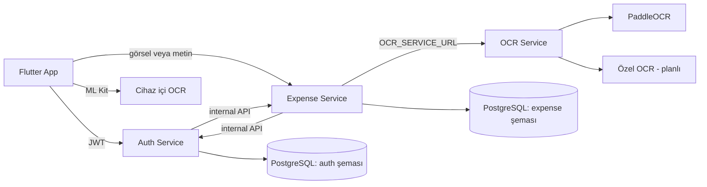

# Akıllı Fiş İşleme ve Mikro Harcama Yönetimi: Yol Haritası

> Son güncelleme: 2026-11-19. Faz 0-9 çekirdek ürün, Faz 10 sonradan eklenen hesap/senkron/kişisel finans katmanı, Bölüm 7 ise gelecek fazlardır. Ayrıntılı uygulama notları için `CLAUDE.md`, API sözleşmesi için `docs/openapi.yaml`.

## 1. Proje Özeti
Kullanıcı fişi **uygulama içi kamerayla** (canlı önizleme, hizalama kılavuzu, flaş ve dokunarak odak) veya galeriden çeker; uzun fişler için 6 sayfaya kadar çekim yapılır. Görsel, cihazdaki ML Kit ile (**cihaz içi OCR**) ya da ayrı bir **OCR servisine** (Python/FastAPI, PaddleOCR) işlenir. Sunucu servisi görseli yalnızca bellekte işler, diske yazmaz ve saklamaz. Hibrit yönlendirme: bulut eşitleme kapalıysa fotoğraf hiç cihazdan çıkmaz; açıkken çevrimiçiyse sunucu OCR'ı, çevrimdışıyken cihaz OCR'ı kullanılır. Çıkan ham metin **Go** backend'inde ayrıştırılır (tutar, tarih, işletme, kalemler, kategori), kullanıcı sonucu onaylar veya düzenler, kayıt **PostgreSQL**'e (çevrimdışıysa önce cihazdaki kuyruğa) yazılır. Ana ekranda haftalık/aylık özet, kategori dağılımı, aylık bütçeler ve tekrarlayan giderler gösterilir.

**OCR motoru stratejisi**
- Strategy + Factory Registry deseni üç katmanda aynı biçimde uygulanır: OCR servisi (`services/ocr/ocr/`), Expense servisi (`internal/scan`, `ocr_engine.go`), mobil uygulama (`lib/ocr/ocr_engine.dart`).
- Sunucu motoru seçimi: istek parametresi `?engine=`, `X-OCR-Engine` başlığı veya `OCR_ENGINE` ortam değişkeni (varsayılan `paddleocr`). Değerler: `paddleocr`, `custom`.
- Ortak yanıt biçimi: `raw_text`, `blocks`, `confidence`, `engine`, `model_version`, `elapsed_ms`.
- `custom` motoru şu an yer tutucudur (stub). Model hazır olunca yalnızca `custom_engine.py` içindeki model yükleme ve çıkarım kısmı değişir.
- Tercihler ekranında "Fiş okuma" modu (Otomatik / Sunucu / Cihaz) ve "Sunucu OCR motoru" seçilir; seçimler cihazda saklanır.

**Mimari kararlar**
- Monorepo yapısı: `/fissio_mobile` (Flutter), `/services/auth`, `/services/expense`, `/services/ocr`, `docker-compose.yml` (+ `docker-compose.prod.yml`, `Caddyfile`).
- DB ve OCR portu dışarı açılmaz, yalnızca Docker iç ağından erişilir (NFR-3). Tek `docker-compose up` ile tüm backend ayağa kalkar (NFR-4).
- Auth ve Expense servisleri JWT'yi (isteğe bağlı EdDSA) kendi içinde doğrular; oturumun canlılığı auth'un **internal API**'si ile sorgulanır, hesap silme expense'in internal API'sini çağırır. Servisler birbirinin şemasına SQL çalıştırmaz.
- Veri modeli: `auth.users/sessions/refresh_tokens/email_otps`; `expense.profiles` → `expenses` (`profile_id`, `client_uid`), `categories`, `category_rules`, `budgets`, `receipt_images`. Fiş fotoğrafları fişe bağlı ve hesaba özel saklanır (fiş silinince silinir); OCR servisi görsel saklamaz.
- **Çevrimdışı-öncelikli mobil**: bulut eşitleme varsayılan AÇIK; ağ hatasında fiş/profil/fotoğraf/bütçe cihaz kuyruğuna alınır ve bağlantı gelince idempotent yüklenir; son sunucu verisi önbelleklenir; çakışma 409 `conflict`. Eşitleme kapalıyken sunucuya hiçbir şey yazılmaz.
- Çok dilde yazılmış mantık (ayrıştırma, tekrarlayan gider serisi, OCR satır kurma) Go/Dart/Python'da çoğaltılır ve `testdata/` altındaki ortak altın vektörlerle sınanır.

## 2. Fazlar

| Faz | Süre | Çıktı | İlgili gereksinimler | Durum |
|---|---|---|---|---|
| 0. Hazırlık | 2-3 gün | Repo, Docker iskeleti, API sözleşmesi (OpenAPI), Figma/wireframe | NFR-4 | Büyük ölçüde tamam |
| 1. Altyapı ve Auth | 1 hafta | Postgres, Auth servisi (OTP'li kayıt/giriş, bcrypt, JWT, oturumlar), JWT middleware | FR-1.1 - 1.4, NFR-3 | Tamam |
| 2. Fiş ayrıştırma motoru | 1-1,5 hafta | `POST /receipts/parse`: tutar, tarih, işletme, kalemler, kategori, mutabakat, örnek fiş test seti | FR-3.1, 3.2 | Tamam |
| 3. Harcama CRUD ve rapor | 1 hafta | `/expenses` CRUD, `/reports/summary?period=week\|month` | FR-4.1 - 4.3 | Tamam |
| 4. Flutter temel | 1 hafta | Giriş/kayıt ekranları, token saklama (secure storage), API istemcisi, navigasyon | FR-1 | Tamam |
| 5. Kamera ve OCR | 1 hafta | **Uygulama içi kamera**, izin akışı, OCR servisi (PaddleOCR), cihaz içi OCR, motor soyutlaması, görseli saklamama | FR-2.1 - 2.4, NFR-1, NFR-2 | Tamam (OCR süre ölçümü açık) |
| 5b. Özel OCR ve motor seçimi | Belirsiz (model hazır olunca) | Özel OCR modelinin eğitimi ve `custom` motoruna bağlanması, motor karşılaştırma testleri | FR-2 | Bekliyor |
| 6. Önizleme/override ve liste | 1 hafta | Onay ekranı, düzenleme, kaydet, harcama listesi, güncelle/sil | FR-3.3, 3.4, FR-4.2 | Büyük ölçüde tamam |
| 7. Analiz ekranı | 4-5 gün | Haftalık/aylık özet, kategori dağılımı, boş durum | FR-4.3, UC-03 | Tamam (grafik kütüphanesi kullanılmadı) |
| 8. Hata yönetimi ve test | 1 hafta | İzin reddi, okunamayan fiş modalı, ağ hatası, birim/entegrasyon/widget testleri | Bölüm 8 | Tamam (E2E senaryo açık) |
| 9. Cilalama ve teslim | 3-4 gün | Dokümantasyon, demo videosu, sunum, gerçek fişlerle son test | Tümü | Sürüyor |
| 10. Hesap, senkron ve kişisel finans | - | OTP'li hesap, profil izolasyonu, offline-first, bütçe, tekrarlayan gider, widget, veri aktarımı | - | Tamam |

Fazlar sonradan netleşen ihtiyaçlara göre genişlemiştir; Faz 10 ilk plana dahil değildi.

## 3. Faz Detayları

### Faz 0: Hazırlık
- [x] Git reposu ve klasör yapısı
- [x] OpenAPI sözleşmesi (`docs/openapi.yaml`): rota tabloları sözleşmeyle `TestRoutesMatchOpenAPISpec` (auth, expense) ve `test_openapi_contract.py` (ocr) ile doğrulanır
- [ ] Flutter, Go ve Docker kurulumu; Android emülatörü veya fiziksel cihaz
- [ ] 15-20 gerçek Türk fişi örneği topla (BİM, Migros, A101, Opet, Shell). Kişisel bilgileri maskele. (Gerçek PaddleOCR çıktıları `realreceipts_test.go` içinde mevcut; ham fotoğraf seti yok.)

### Faz 1: Altyapı ve Auth
- [x] `docker-compose.yml`: postgres (portu dışarı açma), auth, expense, ocr. `healthcheck` ve `depends_on` ekle.
- [x] Şema migrasyonları (`migrate()` her serviste; `db/init.sql` yalnızca şemaları açar)
- [x] Auth: 6 haneli e-posta OTP doğrulaması (SMTP ya da geliştirme için log), şifre sıfırlama (kodla), `bcrypt` (DefaultCost = 10), 15 dk access JWT + 30 gün rotasyonlu refresh token, cihaz/oturum yönetimi (uzaktan çıkış, tüm cihazlardan çıkış), KVKK hesap silme
- [x] Gin JWT middleware (her serviste ayrı `jwt.go`, paylaşılan paket değil; hata kodu sözleşmesi `contract_test.go` ile korunur)
- [x] Birim testleri: yinelenen e-posta, yanlış kod/şifre, süresi dolmuş token (`unit_test.go`, `auth_pg_test.go`)

### Faz 2: Ayrıştırma motoru (projenin çekirdeği)
- [x] **Tutar**: `TOPLAM`, `TOPLAM TUTAR`, `GENEL TOPLAM`, `TUTAR` etiketlerinden sonra `*?\d+[.,]\d{2}` biçimi. Türkçe ondalık virgülünü ve binlik noktasını normalize et. Etiket bulunamazsa en büyük tutarı adaylık olarak kullan. `KDV` satırlarını hariç tut.
- [x] **Tarih**: `dd.MM.yyyy`, `dd/MM/yyyy`, `dd-MM-yy`
- [x] **İşletme**: İlk anlamlı satırlar. Bilinen markalar sözlüğü ile birleştir.
- [x] **Kategori**: 11 sabit kategori, hibrit işletme + kalem sınıflandırması, kullanıcıya özel öğrenilen kurallar. Türkçe büyük/küçük harf normalizasyonu (İ/ı) ve OCR hatalarına tolerans.
- [x] Yanıtta alan başına `confidence` ve `needs_manual` bayrağı dön. Tutar bulunamazsa bu bayrak Bölüm 8'deki modalı tetikler.
- [x] Kalemler, özet satırları (KDV, indirim, ara toplam), toplam mutabakatı (`reconcile`) ve çok sayfalı fiş birleştirme (`MergePageTexts`)
- [x] Tablo tabanlı testler: altın vektörler (`testdata/parse/*.json`) ve gerçek PaddleOCR çıktıları (`realreceipts_test.go`); Go ve Dart aynı vektörleri okur

### Faz 3: Harcama CRUD ve raporlama
- [x] CRUD uçları, her sorguda `user_id` filtresi (başka kullanıcının veriye erişimini engelle)
- [x] Sayfalama ve tarih filtresi; artımlı eşitleme (`?since=`, `/expenses/ids`)
- [x] Rapor: `GROUP BY category` ile haftalık/aylık toplamlar ve yüzde dağılımı
- [x] Tutar için `NUMERIC(12,2)` kullan

### Faz 4-5: Flutter, kamera ve OCR
- [x] State management: düz `ChangeNotifier` (`app_state.dart`), tek HTTP istemcisi (`api.dart`), `flutter_secure_storage`
- [x] **Uygulama içi kamera** (`camera` paketi, `ScanCameraPort` arkasında): canlı önizleme, yarı saydam hizalama çerçevesi, flaş (Kapalı/Otomatik/Sürekli fener), dokunarak odak, 6 sayfaya kadar çoklu çekim + küçük resim şeridi + sayfa silme, "Taramayı başlat" düğmesi, galeri ve manuel giriş geçişi
- [x] Kamera izni reddedilirse çökmek yerine yedek ekran: "Ayarlardan izin ver" (`permission_handler`), galeriden seç, manuel gir
- [x] Kamera yaşam döngüsü: arka plana alınınca kaynak bırakılır, dönünce yeniden açılır; donanım bir port arkasında olduğundan testlerde `MissingPluginException` oluşmaz
- [x] OCR servisi: FastAPI, `/ocr/extract`, PaddleOCR (PP-OCRv4 mobile, `OCR_LANG=tr`); girdi sınırları ve eşzamanlılık kontrolü
- [x] Strategy + Factory Registry: OCR servisi, Expense servisi ve mobil istemcide aynı desen
- [x] **Cihaz içi OCR** (ML Kit) + hibrit yönlendirme (Otomatik / Sunucu / Cihaz)
- [x] Geçici görüntü dosyasını okuduktan sonra `finally` bloğunda sil; galeri orijinaline dokunma (`readAndDelete`, `picked_image_test.dart`) (FR-2.3)
- [ ] OCR süresini ölç ve logla (`elapsed_ms` yanıtta var; hedef değerle karşılaştırma ve raporlama yok). Hedef sunucu tarafında < 3 sn, PaddleOCR ile gerçek ölçüme göre güncellenecek.
- [ ] OCR servisinin görseli diske yazmadığını, loglamadığını ve saklamadığını test ile doğrula. Görsel yalnızca istek süresince bellekte kalır.

### Faz 5b: Özel OCR ve motor seçimi
- [ ] Eğitim verisi: Faz 0'daki gerçek fiş örneklerini etiketle ve genişlet
- [ ] Fişe özel model (ONNX Runtime, TorchScript veya TFLite) eğit ve değerlendir
- [ ] `custom_engine.py` içinde `_load_model` ve `_run_inference` uygula, stub'ı kaldır
- [x] Tercihler ekranında sunucu OCR motoru seçici (PaddleOCR / Özel OCR), seçim cihazda kalıcı (`pref_ocr_engine`)
- [x] Seçilen motoru OCR isteğiyle (`engine` parametresi) gönder (yanıttaki `engine`/`model_version` OCR `metadata` ile istemciye iletilir, fişe kaydedilmez)
- [ ] Karşılaştırma: aynı fiş setinde iki motorun tutar doğruluğu ve süresini ölç, sonucu belgele
- [ ] Özel motor yüklenemezse PaddleOCR'a düşme davranışını belirle ve kullanıcıya bildir

### Faz 6-7: Kullanıcı arayüzü
- [x] Önizleme formu: tutar, tarih, kategori, işletme adı ve kalemler tek ekranda (`receipt_form_page.dart`); fotoğraflar fişe eklenir
- [x] Liste ekranı: aya göre gruplu liste, detay, düzenleme, silme.
- [ ] Liste ekranı: kaydırarak silme
- [x] Ana ekran/analiz: hafta/ay seçici, toplam ve önceki dönemle karşılaştırma, kategori dağılımı çubukları, boş durum ekranı (`home_page.dart`, `stats.dart`)

### Faz 8: Hata yönetimi ve test
- [x] Kamera izni reddedildi → yedek ekran, ayarlar bağlantısı, galeri ve manuel yolları (`scan_camera_test.dart`)
- [x] OCR boş veya tutar bulunamadı → "Fiş net okunamadı, bilgileri manuel girmek ister misiniz?" modalı
- [x] Ağ hatası → fiş cihaz kuyruğuna alınır, başlıkta küçük çevrimdışı rozeti gösterilir, bağlantı gelince otomatik yüklenir (SRS 7. madde için çözüm: kullanıcı veri kaybetmez)
- [x] 401 yanıtı → sessiz token yenileme; yenileme reddedilirse otomatik çıkış
- [x] Test: Go birim ve PG'li entegrasyon testleri, OCR pytest, Flutter widget/birim testleri (`flutter test`), mimari sözleşme testleri, CI (`.github/workflows/ci.yml`)
- [ ] 1-2 uçtan uca senaryo otomasyonu (şu an docker yığınında elle doğrulanıyor)

### Faz 10: Hesap, senkron ve kişisel finans
- [x] E-posta OTP ile doğrulanan hesap, şifre sıfırlama, oturum/cihaz yönetimi (`sessions_page.dart`), hesap silme (auth ↔ expense internal API, ertelenen silme süpürücüsü)
- [x] Hesap bazlı profil izolasyonu: `User → Profiles → Receipts`, profil avatarları, hesap/profil arası erişim 404
- [x] Varsayılan bulut senkronu + tam offline-first mimari: kuyruk, okuma önbelleği, çevrimdışı düzenleme/silme, çakışma (409), üstel geri çekilme, disk görsel önbelleği
- [x] Cihaz içi ML Kit OCR + hibrit yönlendirme; cihaz tarafı ayrıştırıcı (Dart) altın vektörlerle Go ile eşitlenir
- [x] Kategori bazlı ve toplam aylık bütçe limitleri (%80 uyarı, %100 aşım bildirimi)
- [x] Sabit/değişken tekrarlayan gider projeksiyonu (seri tekilleştirme, ödenen/kalan, 3 aylık ortalama), hatırlatma bildirimleri
- [x] Android ana ekran widget'ı (aylık toplam, "Fiş tara" kısayolu)
- [x] JSON/CSV içe/dışa aktarım (Veri Yönetimi)
- [x] Marka paleti, tema ve uygulama ikonu seçimi; ilk kullanım tanıtım rehberi; destek/hakkında/gizlilik sayfaları
- [x] Üretim sertleştirmesi: DB rolleri, EdDSA JWT, zayıf sır kontrolü, Caddy ile TLS ve tek origin, hız/eşzamanlılık sınırları
- [x] Mimari sözleşme testleri: OpenAPI rota testleri, hata kodu sözleşmesi (`contract_test.go`), Go/Dart/Python altın vektörleri

## 4. Riskler

| Risk | Etki | Önlem |
|---|---|---|
| OCR kalitesi düşük (buruşuk, soluk termal fiş) | Yüksek | Uygulama içi kamerada çekim rehberi çerçevesi, flaş/fener ve dokunarak odak (uygulandı), çok sayfalı çekim, manuel giriş yedeği |
| Fiş şablonlarının çeşitliliği | Orta | Test seti büyüt, kuralları veri odaklı tut, kullanıcıya özel öğrenilen kurallar |
| PaddleOCR sunucuda ağır çalışır (CPU süresi, imaj boyutu, bellek) | Orta | Mobile model varyantı, çıkarım kilidi + işçi süreçleri, bellek sınırı, ölçüm ve loglama, gerekirse GPU seçeneği (`OCR_USE_GPU`) |
| Özel OCR modeli PaddleOCR kalitesine ulaşamaz | Orta | Varsayılan motor PaddleOCR kalır, motor seçimi kullanıcıya açık, karşılaştırma testi |
| Görselin ağ üzerinden OCR servisine gitmesi (gizlilik) | Orta | Bulut eşitleme kapalıyken cihaz OCR'ı zorunlu (fotoğraf cihazdan çıkmaz), servis içi ağ, OCR servisi diske yazmaz ve saklamaz |
| Fiş fotoğraflarının sunucuda saklanması (KVKK/gizlilik) | Orta | Yalnızca sahibinin JWT'siyle erişim (sahiplik JOIN ile doğrulanır), fiş silinince CASCADE ile silinir, hesap silmede tüm veri temizlenir, jpeg/png/webp dışı reddedilir; veri büyürse dosya sistemi/nesne depolamaya taşınır (Bölüm 7) |
| Kamera/izin farklılıkları (cihaz, işletim sistemi sürümü) | Orta | Donanım `ScanCameraPort` arkasında; açılamazsa yedek ekran (galeri/manuel), her cihazda gerçek kamera elle doğrulanmalı |
| JWT sırrının kod içinde kalması | Orta | `.env` ve compose değişkenleri; `APP_ENV=production` zayıf sırları reddeder; isteğe bağlı EdDSA anahtar çifti |
| Mantığın Go/Dart/Python'da çoğaltılması (sapma riski) | Orta | `testdata/` altın vektörleri, kaynak-gerçek tablosu (`CLAUDE.md`), sözleşme testleri |
| Kapsam büyümesi | Orta | Çoklu para birimi gibi özellikler bu sürümün dışında; yeni fikirler Bölüm 7'de sıralı |

## 5. SRS'te Netleştirilmesi Gereken Noktalar
1. **Servis ayrımı**: Tek Postgres, ayrı şemalar (`auth`, `expense`); servisler birbirinin şemasına dokunmaz, internal API ile konuşur. (Karar verildi)
2. **API gateway**: Üretimde Caddy ile tek origin (`/auth/*` → auth, diğerleri → expense). Geliştirmede istemci iki porta bağlanır. (Karar verildi)
3. **Refresh token**: uygulandı (15 dk access + 30 gün tek kullanımlık refresh, DB'de hash'li; bkz. CLAUDE.md).
4. **Ham metin saklama**: SRS "işlenmiş metin" saklandığını söylüyor. `raw_text` kolonunun tutulup tutulmayacağını belirle (KVKK açısından da önemli). (Açık)
5. **Kategori listesi**: 11 sabit kategori ile başlandı; kullanıcıya özel kurallar ve anahtar kelimeler öğrenilir. Kullanıcı kategori ekleyemez. (Karar verildi)
6. **Platform**: Android öncelikli ve doğrulanmış; iOS kodu hazır ama ana ekran widget hedefi ve cihaz doğrulaması Mac gerektirir. (Kısmen açık)
7. **Ağ hatasında kayıt**: Çözüldü: fiş çevrimdışı kuyruğa alınır, form verisi kaybolmaz.

## 6. Kabul Kriterleri
- [ ] `docker-compose up` ile servisler ek ayar olmadan çalışır; dışarıdan Postgres ve OCR portuna bağlanılamaz. (Yığın doğrulandı; temiz makinede son kontrol açık)
- [x] Fiş çekimi (uygulama içi kamera) → önizleme → kayıt akışı çalışır.
- [x] Fiş fotoğrafları yalnızca fişe bağlı ve hesaba özel saklanır: OCR servisi diske yazmaz/saklamaz, fiş silinince fotoğrafları da silinir, başka kullanıcı erişemez, cihazdaki geçici dosya silinmiştir (galeri orijinaline dokunulmaz).
- [x] Uzun fişler için birden fazla fotoğraf (uygulama içi kamerada peş peşe çekim veya galeriden çoklu seçim) tek fiş olarak taranır; fotoğraflar fiş detayında görüntülenir.
- [ ] OCR süresi ölçülür ve hedef değerin altındadır (sunucu tarafı).
- [x] Tercihler'den OCR modu (Otomatik/Sunucu/Cihaz) ve sunucu motoru (PaddleOCR/Özel OCR) seçilebilir, seçilen motor OCR isteğinde kullanılır. (Özel motor hâlâ stub)
- [x] Haftalık ve aylık özetler doğru toplamları gösterir (`stats_test.dart`, `reports/summary` testleri).
- [x] Bölüm 8'deki hata senaryoları çalışır (kamera izni reddi, okunamayan fiş, ağ hatası/çevrimdışı, oturum süresi dolması).

## 7. Gelecek Fazlar
Öncelik sırası önerisidir; her madde ayrı bir PR/faz olarak ele alınır.

### Faz 11: Go servisleri arası ortak modül sadeleştirmesi
Bugün `auth` ve `expense` ayrı `go.mod` dosyalarıdır; `jwt.go` (token doğrulama), hata kodu sözleşmesi, ortam değişkeni okuma yardımcıları (`envint`), CORS/internal-token ara katmanları iki yerde kopyadır ve yalnızca `contract_test.go` ikilisiyle senkron tutulur.
- [ ] Ortak paketi belirle (JWT doğrulama, hata kodları, config yardımcıları, internal-token middleware) ve `go.work` + ortak `internal`/`pkg` modülü ile tek kaynağa indir
- [ ] Kopya testleri (`contract_test.go`, `envint_test.go`, `accesskeys_test.go`) tek yerde birleştir; davranış değişmediğini mevcut testlerle kanıtla
- [ ] Docker imajlarının ortak modülü derleme bağlamına alması (`.dockerignore`, katman önbelleği)

### Faz 12: `ledger` / `media` paket ayrımı (expense)
`package main` içinde ~2.500 satır handler/DB/gin birbirine bağlı; saf mantık (`receiptparse`, `scan`) zaten ayrıldı, kalan kısım ertelendi.
- [ ] `internal/ledger`: harcamalar, profiller, bütçeler, tekrarlayan giderler, kurallar, raporlar (HTTP'den bağımsız servis katmanı + depo arayüzü)
- [ ] `internal/media`: fiş fotoğrafları ve avatarlar, `BlobStore` arayüzü (Postgres `bytea` uygulaması; ileride dosya sistemi/nesne depolama)
- [ ] Taşıma sırasında davranış korunur: `isolation_pg_test`, `integration_pg_test`, OpenAPI rota testi yeşil kalır

### Faz 13: Ürün bazlı fiyat değişimi ve enflasyon takibi
Bugün kalemler fişin JSONB alanında `{name, amount, category_id}` olarak durur; ürün kimliği ve birim fiyat yok.
- [ ] Kalem adı normalizasyonu ve eşleştirme (marka/gramaj, `foldTR`, benzerlik) ile `expense.products` tablosu
- [ ] Adet/birim fiyat çıkarımı (ayrıştırıcıdaki miktar satırlarından) ve ürün başına fiyat zaman serisi
- [ ] Mobil: ürün/sepet fiyat geçmişi grafiği, "bu ürün X% zamlandı" uyarısı, kişisel enflasyon (sık alınan sepet) göstergesi
- [ ] Gizlilik: yalnızca kullanıcının kendi verisinden; cihaz içi hesaplama seçeneği (eşitleme kapalıysa)

### Faz 14: Garanti ve iade süresi takibi
- [ ] Fişe isteğe bağlı "garanti bitişi" ve "iade son günü" alanları (`expenses` sütunları, `/expenses` ve toplu yükleme, JSON yedeği ve OpenAPI güncellemesi)
- [ ] Fiş formunda hızlı seçici (14 gün iade, 1/2 yıl garanti) ve işletme türüne göre öneri
- [ ] Yaklaşan bitişler listesi ve hatırlatma bildirimleri (tekrarlayan gider hatırlatma altyapısı `planReminders` yeniden kullanılır)
- [ ] Fiş fotoğrafı garanti belgesi olarak kolay erişim (fiş detayında "garanti" filtresi)

### Diğer açık işler
- [ ] iOS ana ekran widget hedefi (Xcode, App Group, gece yarısı timeline yenilemesi; kaynak `ios/FissioWidget/` hazır)
- [ ] Release derlemesinin https üzerinden gerçek cihazda doğrulanması (Caddy + güvenilir sertifika, `--dart-define=API_BASE=https://...`)
- [ ] Uygulama içi kameranın gerçek cihazlarda (Android + iOS) elle doğrulanması: flaş/fener, odak, ön plan-arka plan geçişi
- [ ] Özel OCR motoru (Faz 5b) ve motor karşılaştırması
- [ ] Liste ekranında kaydırarak silme; E2E senaryo otomasyonu; OCR süre ölçümü ve raporu
