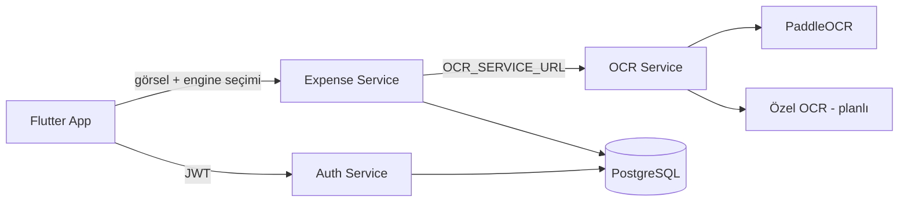

# Akıllı Fiş İşleme ve Mikro Harcama Yönetimi: Yol Haritası

## 1. Proje Özeti
Kullanıcı fişi telefon kamerasıyla çeker. Görsel, ayrı bir **OCR servisine** (Python/FastAPI) gönderilir. Servis görseli yalnızca bellekte işler, diske yazmaz ve saklamaz. OCR motoru olarak şimdilik **PaddleOCR** (PP-OCRv4 mobile, Türkçe) kullanılır. İleride kendi geliştireceğimiz **özel OCR modeli** eklenecek ve kullanıcı **Ayarlar**'dan iki motor arasında seçim yapabilecek. Çıkan ham metin **Go** backend'inde regex ile ayrıştırılır (tutar, tarih, işletme adı), anahtar kelimeyle kategori önerilir. Kullanıcı sonucu onaylar veya düzenler, kayıt **PostgreSQL**'e yazılır. Analiz sekmesinde haftalık ve aylık grafikler gösterilir.

**OCR motoru stratejisi**
- Strategy + Factory Registry deseni üç katmanda aynı biçimde uygulanır: OCR servisi (`services/ocr/ocr/`), Expense servisi (`ocr_engine.go`), mobil uygulama (`lib/ocr/ocr_engine.dart`).
- Motor seçimi: istek parametresi `?engine=`, `X-OCR-Engine` başlığı veya `OCR_ENGINE` ortam değişkeni (varsayılan `paddleocr`). Değerler: `paddleocr`, `custom`.
- Ortak yanıt biçimi: `raw_text`, `blocks`, `confidence`, `engine`, `model_version`, `elapsed_ms`.
- `custom` motoru şu an yer tutucudur (stub). Model hazır olunca yalnızca `custom_engine.py` içindeki model yükleme ve çıkarım kısmı değişir, API ve diğer katmanlar değişmez.
- Ayarlar ekranında kullanıcıya motor seçimi sunulur, seçim cihazda saklanır ve her OCR isteğinde gönderilir. Özel motor hazır olana kadar seçenek pasif (veya "yakında") gösterilir.

**Mimari kararlar**
- Monorepo yapısı: `/fissio_mobile` (Flutter), `/services/auth`, `/services/expense`, `/services/ocr`, `docker-compose.yml`.
- DB portu dışarı açılmaz, yalnızca Docker iç ağından erişilir (NFR-3).
- Tek `docker-compose up` ile tüm backend ayağa kalkar (NFR-4). Migrasyonlar ve `.env` varsayılanları otomatik gelir.
- Auth ve Expense servisleri JWT sırrını paylaşır. Expense servisi token'ı kendi içinde doğrular.
- Veri modeli: `users(id, email, password_hash, created_at)`, `categories(id, name, keywords[])`, `expenses(id, user_id, merchant, amount, date, category_id, raw_text, created_at)`. Görsel hiçbir yerde saklanmaz.

## 2. Fazlar

| Faz | Süre | Çıktı | İlgili gereksinimler |
|---|---|---|---|
| 0. Hazırlık | 2-3 gün | Repo, Docker iskeleti, API sözleşmesi (OpenAPI), Figma/wireframe | NFR-4 |
| 1. Altyapı ve Auth | 1 hafta | Postgres, Auth servisi (register/login, bcrypt, JWT), JWT middleware | FR-1.1 - 1.4, NFR-3 |
| 2. Fiş ayrıştırma motoru | 1-1,5 hafta | `POST /receipts/parse`: regex (tutar, tarih, işletme), kategori eşleme, örnek fiş test seti | FR-3.1, 3.2 |
| 3. Harcama CRUD ve rapor | 1 hafta | `/expenses` CRUD, `/reports/summary?period=week\|month` | FR-4.1 - 4.3 |
| 4. Flutter temel | 1 hafta | Login/kayıt ekranları, token saklama (secure storage), API istemcisi, navigasyon | FR-1 |
| 5. Kamera ve OCR (PaddleOCR) | 1 hafta | Kamera, izin akışı, OCR servisi (PaddleOCR), motor soyutlaması (Strategy/Factory), görseli saklamama | FR-2.1 - 2.4, NFR-1, NFR-2 |
| 5b. Özel OCR ve motor seçimi | Belirsiz (model hazır olunca) | Özel OCR modelinin eğitimi ve `custom` motoruna bağlanması, Ayarlar'da PaddleOCR / Özel OCR seçimi, motor karşılaştırma testleri | FR-2 |
| 6. Önizleme/override ve liste | 1 hafta | Onay ekranı, düzenleme, kaydet, harcama listesi, güncelle/sil | FR-3.3, 3.4, FR-4.2 |
| 7. Analiz ekranı | 4-5 gün | Haftalık/aylık pasta ve çubuk grafikler (`fl_chart`) | FR-4.3, UC-03 |
| 8. Hata yönetimi ve test | 1 hafta | İzin reddi, okunamayan fiş modalı, ağ hatası, birim/entegrasyon/E2E testleri | Bölüm 8 |
| 9. Cilalama ve teslim | 3-4 gün | Dokümantasyon, demo videosu, sunum, gerçek fişlerle son test | Tümü |

Toplam yaklaşık 7-8 hafta. İki kişi paralel çalışırsa Faz 1-3 (backend) ile Faz 4-5 (mobil) aynı anda ilerleyebilir.

## 3. Faz Detayları

### Faz 0: Hazırlık
- [x] Git reposu ve klasör yapısı
- [ ] OpenAPI sözleşmesi: `/auth/register`, `/auth/login`, `/receipts/parse`, `/expenses`, `/reports/summary`
- [ ] Flutter, Go ve Docker kurulumu; Android emülatörü veya fiziksel cihaz
- [ ] 15-20 gerçek Türk fişi örneği topla (BİM, Migros, A101, Opet, Shell). Kişisel bilgileri maskele.

### Faz 1: Altyapı ve Auth
- [x] `docker-compose.yml`: postgres (portu dışarı açma), auth, expense. `healthcheck` ve `depends_on` ekle.
- [x] SQL migrasyonları (`golang-migrate` veya init SQL)
- [x] Auth: e-posta doğrulama, `bcrypt` (cost ≥ 10), JWT süresi 24 saat, `/auth/login` (şu an yalnızca e-posta biçim doğrulaması var, onay e-postası yok; bcrypt DefaultCost = 10)
- [x] Gin JWT middleware paylaşılan paketi (her serviste ayrı `jwt.go`, paylaşılan paket değil)
- [ ] Birim testleri: yinelenen e-posta, yanlış şifre, süresi dolmuş token

### Faz 2: Ayrıştırma motoru (projenin çekirdeği)
- [x] **Tutar**: `TOPLAM`, `TOPLAM TUTAR`, `GENEL TOPLAM`, `TUTAR` etiketlerinden sonra `*?\d+[.,]\d{2}` biçimi. Türkçe ondalık virgülünü ve binlik noktasını normalize et. Etiket bulunamazsa en büyük tutarı adaylık olarak kullan. `KDV` satırlarını hariç tut.
- [x] **Tarih**: `dd.MM.yyyy`, `dd/MM/yyyy`, `dd-MM-yy`
- [x] **İşletme**: İlk anlamlı satırlar. Bilinen markalar sözlüğü ile birleştir.
- [x] **Kategori**: Veritabanında tutulan anahtar kelime tablosu. Türkçe büyük/küçük harf normalizasyonu (İ/ı) ve OCR hatalarına tolerans.
- [x] Yanıtta alan başına `confidence` ve `needs_manual` bayrağı dön. Tutar bulunamazsa bu bayrak Bölüm 8'deki modalı tetikler.
- [ ] Tablo tabanlı testler, örnek fişlerle ≥ %80 tutar doğruluğu hedefi

### Faz 3: Harcama CRUD ve raporlama
- [x] CRUD uçları, her sorguda `user_id` filtresi (başka kullanıcının veriye erişimini engelle)
- [x] Sayfalama ve tarih filtresi
- [x] Rapor: `GROUP BY category` ile haftalık/aylık toplamlar ve yüzde dağılımı
- [x] Tutar için `NUMERIC(12,2)` kullan

### Faz 4-5: Flutter, kamera ve OCR
- [x] State management: düz `ChangeNotifier` (`app_state.dart`), tek HTTP istemcisi (`api.dart`), `flutter_secure_storage`
- [ ] `camera` veya `image_picker`, `permission_handler` (reddedilirse ayarlara yönlendir)
- [x] OCR servisi: FastAPI, `/ocr/extract`, PaddleOCR (PP-OCRv4 mobile, `OCR_LANG=tr`)
- [x] Strategy + Factory Registry: OCR servisi, Expense servisi ve mobil istemcide aynı desen
- [ ] Geçici görüntü dosyasını OCR sonrası `finally` bloğunda sil. Bunu birim testiyle doğrula (FR-2.3).
- [ ] OCR süresini ölç ve logla (`elapsed_ms`). Hedef sunucu tarafında < 3 sn, PaddleOCR ile gerçek ölçüme göre güncellenecek.
- [ ] OCR servisinin görseli diske yazmadığını, loglamadığını ve saklamadığını test ile doğrula. Görsel yalnızca istek süresince bellekte kalır.

### Faz 5b: Özel OCR ve motor seçimi
- [ ] Eğitim verisi: Faz 0'daki gerçek fiş örneklerini etiketle ve genişlet
- [ ] Fişe özel model (ONNX Runtime, TorchScript veya TFLite) eğit ve değerlendir
- [ ] `custom_engine.py` içinde `_load_model` ve `_run_inference` uygula, stub'ı kaldır
- [ ] Ayarlar ekranına motor seçici ekle (PaddleOCR / Özel OCR), seçimi cihazda sakla (şu an motor seçici Tara ekranında, Ayarlar'da değil ve kalıcı değil)
- [x] Seçilen motoru OCR isteğiyle (`engine` parametresi) gönder, yanıttaki `engine` ve `model_version` alanını kaydet (`engine` gönderiliyor; yanıttaki `engine`/`model_version` henüz kaydedilmiyor)
- [ ] Karşılaştırma: aynı fiş setinde iki motorun tutar doğruluğu ve süresini ölç, sonucu belgele
- [ ] Özel motor yüklenemezse PaddleOCR'a düşme davranışını belirle ve kullanıcıya bildir

### Faz 6-7: Kullanıcı arayüzü
- [x] Önizleme formu: tutar, tarih, kategori dropdown ve işletme adı (`receipt_form_page.dart`)
- [ ] Liste ekranı: kaydırarak silme, düzenleme
- [ ] Analiz sekmesi: hafta/ay seçici, pasta grafik, kategori çubukları, boş durum ekranı

### Faz 8: Hata yönetimi ve test
- [ ] Kamera izni reddedildi → uyarı ve ayarlar bağlantısı
- [x] OCR boş veya tutar bulunamadı → "Fiş net okunamadı, bilgileri manuel girmek ister misiniz?" modalı
- [x] Ağ hatası → kuyruğa almadan anlık hata mesajı (SRS gereği)
- [x] 401 yanıtı → otomatik çıkış
- [ ] Test: Go birim ve entegrasyon testleri (`testcontainers`), Flutter widget testleri, 1-2 uçtan uca senaryo

## 4. Riskler

| Risk | Etki | Önlem |
|---|---|---|
| OCR kalitesi düşük (buruşuk, soluk termal fiş) | Yüksek | Çekim rehberi çerçevesi, flaş, manuel giriş yedeği |
| Fiş şablonlarının çeşitliliği | Orta | Test seti büyüt, kuralları veri odaklı tut |
| PaddleOCR sunucuda ağır çalışır (CPU süresi, imaj boyutu) | Orta | Mobile model varyantı, ölçüm ve loglama, gerekirse GPU seçeneği (`OCR_USE_GPU`) |
| Özel OCR modeli PaddleOCR kalitesine ulaşamaz | Orta | Varsayılan motor PaddleOCR kalır, motor seçimi kullanıcıya açık, karşılaştırma testi |
| Görselin ağ üzerinden OCR servisine gitmesi (gizlilik) | Orta | Servis içi ağ, diske yazmama, saklamama, kullanıcıya bilgilendirme metni |
| JWT sırrının kod içinde kalması | Orta | `.env` ve compose değişkenleri, varsayılan geliştirme değeri |
| Kapsam büyümesi | Orta | Offline kuyruk, çoklu para birimi gibi özellikler bu sürümün dışında |

## 5. SRS'te Netleştirilmesi Gereken Noktalar
1. **Servis ayrımı**: Auth ve Expense ayrı veritabanı mı kullanacak, yoksa aynı Postgres içinde ayrı şemalar mı? Öneri: tek Postgres, ayrı şemalar.
2. **API gateway**: İstemci iki servise ayrı portlardan mı bağlanacak, yoksa tek giriş noktası (Nginx) mı olacak? Öneri: Nginx ile tek giriş (opsiyonel).
3. **Refresh token**: SRS'te yok, yalnızca süreli JWT var. Süre dolunca yeniden giriş yapılacak.
4. **Ham metin saklama**: SRS "işlenmiş metin" saklandığını söylüyor. `raw_text` kolonunun tutulup tutulmayacağını belirle (KVKK açısından da önemli).
5. **Kategori listesi**: Sabit mi, kullanıcı eklenebilir mi? Öneri: sabit liste ile başla.
6. **Platform**: Önce yalnızca Android mi, yoksa iOS de mi? iOS için Mac gerekir.
7. **Ağ hatasında kayıt**: Kayıt aşamasında bağlantı kesilirse kullanıcı girdiği veriyi kaybeder. Formu ekranda tutup "tekrar dene" düğmesi sunmak SRS'e aykırı olmaz.

## 6. Kabul Kriterleri
- [ ] `docker-compose up` ile servisler ek ayar olmadan çalışır; dışarıdan Postgres portuna bağlanılamaz.
- [ ] Fiş çekimi → önizleme → kayıt akışı çalışır.
- [ ] Görsel hiçbir yerde saklanmaz: OCR servisi diske yazmaz, veritabanında görsel yoktur, cihazdaki geçici dosya silinmiştir.
- [ ] OCR süresi ölçülür ve hedef değerin altındadır (sunucu tarafı).
- [ ] Ayarlar'dan PaddleOCR ve Özel OCR arasında seçim yapılabilir, seçilen motor OCR isteğinde kullanılır.
- [ ] Haftalık ve aylık raporlar doğru toplamları gösterir.
- [ ] Bölüm 8'deki üç hata senaryosu çalışır.
